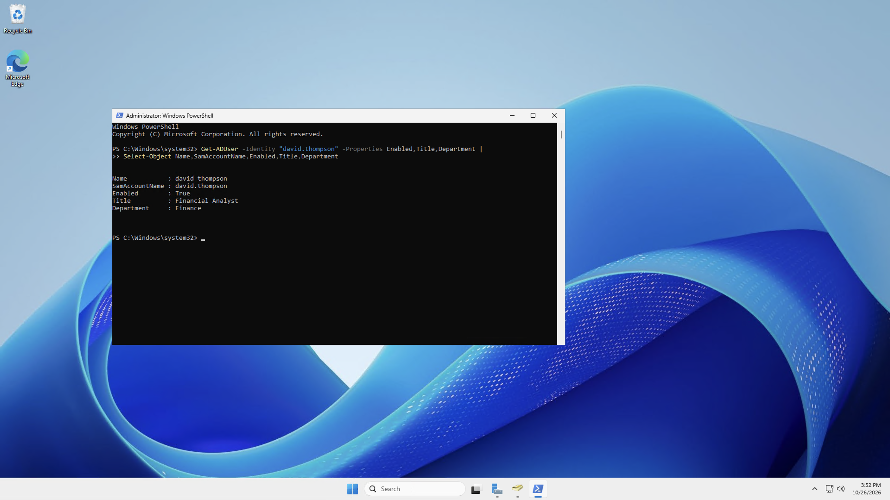
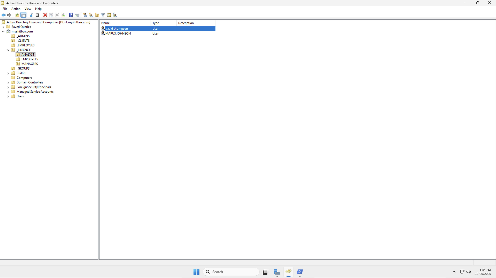
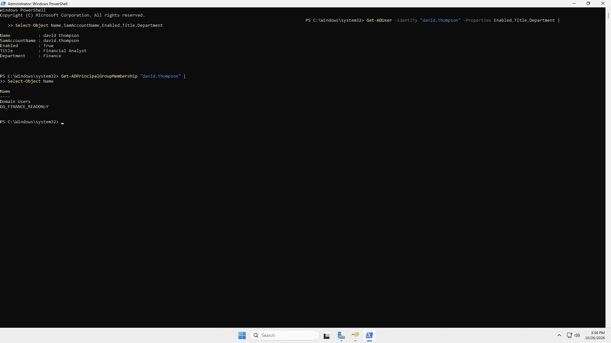
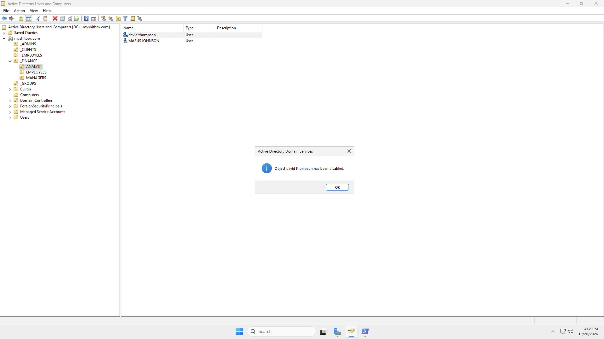
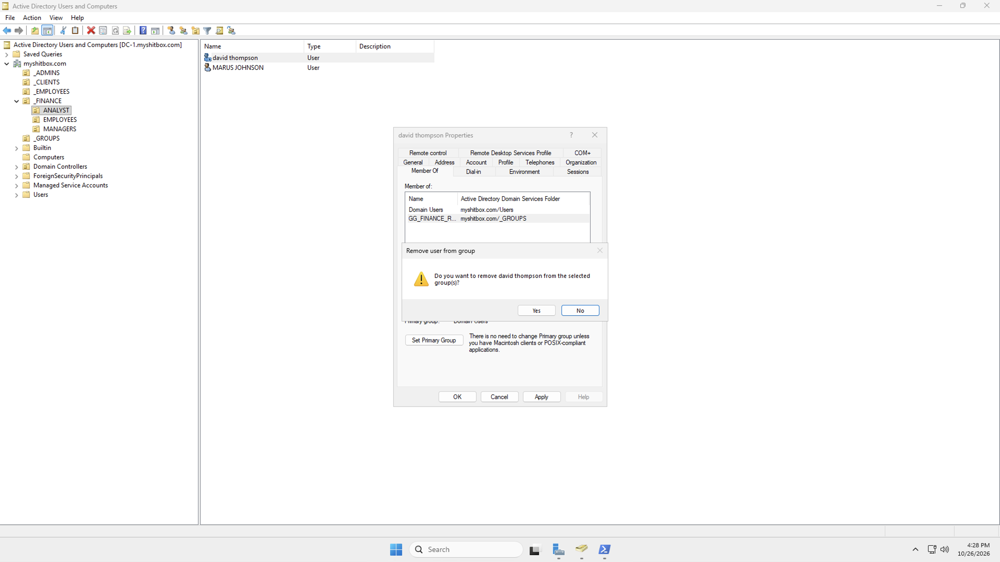
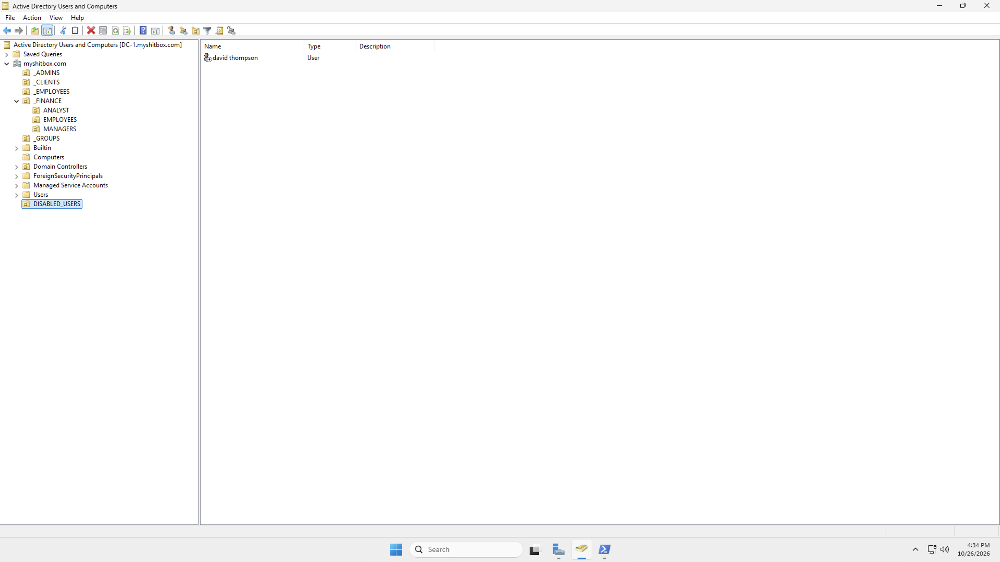
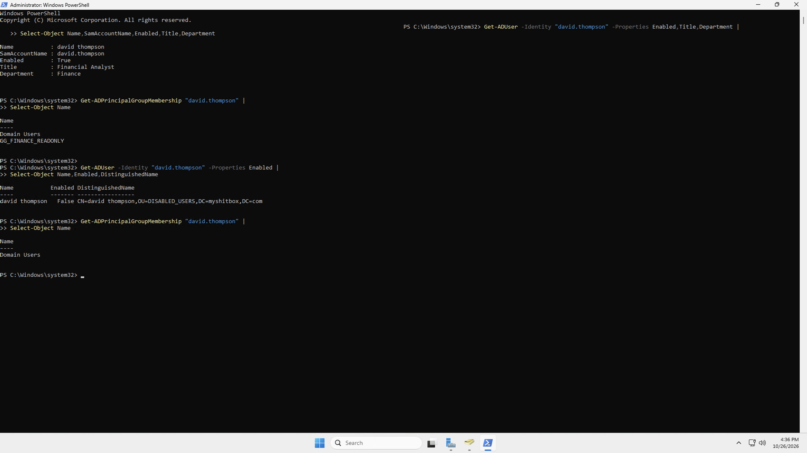
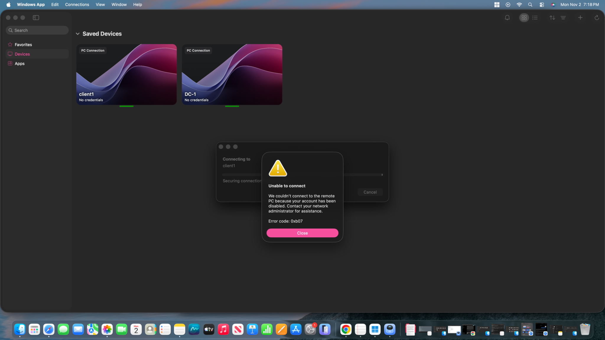

# Active Directory IAM Lab — Leaver (Employee Offboarding)

  

## Project overview

This hands-on lab documents the **Leaver** phase of the Joiner–Mover–Leaver (JML) identity lifecycle. I used **Active Directory Users and Computers (ADUC)** and **Windows PowerShell** to review a departing employee's account, disable the identity, remove departmental group access, and validate the directory state.

The evidence is from my own Azure-hosted Active Directory homelab. Each screenshot below is included in this repository and linked using its relative file path.

## Business scenario

- **Employee:** David Thompson (fictional lab identity)
- **Department:** Finance
- **Change request:** Employee separation / access deprovisioning
- **Desired outcome:** Disable the domain account and remove Finance access; preserve an audit trail of changes
- **Environment:** Windows Server domain controller (DC-1), AD DS, ADUC, PowerShell, and a Windows client VM (Client-1)

## Tools and skills

| Tools / environment | IAM competencies |
| --- | --- |
| Active Directory Domain Services | Identity lifecycle management |
| ADUC | User account administration and OU management |
| Windows PowerShell / ActiveDirectory module | Identity and membership verification |
| Azure-hosted Windows VMs | Domain administration and client testing |
| Security groups | Access revocation and least privilege |

## Lab workflow and screenshot evidence

### 1. Inspect the employee's directory record

I began by querying the employee account in PowerShell to establish the initial identity and department attributes before offboarding. Capturing a baseline makes it easier to verify changes afterward.



### 2. Locate the employee in ADUC

I opened Active Directory Users and Computers and navigated the organizational unit (OU) structure to locate the account for administration.



### 3. Review existing group memberships

Before removing permissions, I checked the employee's current security group memberships using PowerShell. This provides a record of the access that must be evaluated during offboarding.



### 4. Disable the Active Directory account

I used ADUC's account administration controls to disable the departing user's account. Disabling the identity is the central control for preventing new domain authentication using that account.



### 5. Remove departmental security group access

I reviewed the account's group membership properties and removed the Finance-related membership, reducing residual authorization granted through that group.



### 6. Review account placement in ADUC

I reviewed the account in the ADUC organizational unit structure as part of the offboarding workflow. In this lab, the intended destination for inactive identities was the `DISABLED_USERS` OU.



### 7. Validate the post-change account state

I returned to PowerShell to check account attributes and memberships after the administrative changes. This is the most important evidence for confirming that account disablement and Finance group removal were applied in Active Directory.



### 8. Verify Remote Desktop access is denied for the disabled account

After disabling David Thompson's Active Directory account, I attempted a new Remote Desktop connection to **Client-1** through Windows App using the offboarded account. Windows App rejected the connection with an explicit account-status message:

> We couldn't connect to the remote PC because your account has been disabled.

**Error code:** `0xb07`  
**Result:** **PASS — Remote Desktop connection rejected because the account was disabled.**



This is stronger than a generic network connectivity error: the message identifies **account disablement** as the reason the remote session could not be established. The screenshot demonstrates rejection of this new RDP connection; it does not establish that all existing sessions or independent application tokens were revoked.

## Results

| Control / test | Outcome | Evidence |
| --- | --- | --- |
| Employee identity review | Documented | Steps 1–2 |
| Baseline group membership review | Documented | Step 3 |
| Account disable action | Documented in ADUC | Step 4 |
| Departmental group access removal | Documented | Step 5 |
| OU/account review | Documented | Step 6 |
| Post-change directory verification | Documented | Step 7 |
| New Client-1 Remote Desktop connection rejected for disabled account | **PASS** — Windows App explicitly reports disabled account (`0xb07`) | Step 8 |

**Scope note:** AD account disabling does not automatically terminate every existing session or revoke access in independent cloud/SaaS applications. Production offboarding may additionally require session/token revocation, application deprovisioning, device recovery, and ticket approvals.

## PowerShell commands used for verification

The example commands below illustrate repeatable account checks. Confirm the correct `SamAccountName` in your environment before running them. Administrative changes should be performed only on authorized lab accounts.

```powershell
Import-Module ActiveDirectory

# Inspect identity and enabled state
Get-ADUser -Identity 'david.thompson' -Properties Department,Enabled,DistinguishedName |
    Select-Object Name,SamAccountName,Department,Enabled,DistinguishedName

# Inspect group memberships
Get-ADPrincipalGroupMembership -Identity 'david.thompson' |
    Select-Object Name

# Disable account (administrative action)
Disable-ADAccount -Identity 'david.thompson'

# Verify disabled status
Get-ADUser -Identity 'david.thompson' -Properties Enabled |
    Select-Object Name,Enabled
```

See [`scripts/verify-leaver.ps1`](scripts/verify-leaver.ps1) for a reusable **read-only** verification script.

## Security principles demonstrated

- **Identity lifecycle management:** handling access when employment ends
- **Deprovisioning:** disabling accounts and removing memberships
- **Least privilege:** removing access no longer needed
- **Role-based access control (RBAC):** managing access via security groups
- **Verification and audit evidence:** checking the resulting directory state and retaining screenshots

## Business outcome

This lab demonstrates a repeatable employee offboarding workflow: establish an identity and access baseline, disable the departing employee’s AD account, remove Finance group access, and verify the resulting directory state with PowerShell. These controls reduce the risk of former employees retaining unnecessary access and create a clear record for IAM review. The Client-1 Remote Desktop test confirms that a new connection using the disabled account was rejected with an account-disabled error.

## Repository structure

```text
Active-Directory-IAM-Leaver/
├── README.md
├── images/
│   ├── 01-account-baseline.png
│   ├── 02-aduc-account-location.png
│   ├── 03-group-membership-baseline.png
│   ├── 04-disable-account.png
│   ├── 05-remove-finance-membership.png
│   ├── 06-account-ou-review.png
│   ├── 07-powershell-postchange-verification.png
│   └── 08-disabled-account-rdp-denied.png
├── scripts/
│   └── verify-leaver.ps1
└── docs/
    └── evidence-index.md
```

## Lessons learned

Offboarding should be **verified**, not merely performed. ADUC changes should be checked with PowerShell, and an explicit disabled-account authentication rejection is distinct from a generic connectivity failure. Clear screenshots and documented limitations make IAM evidence more trustworthy.

## Author

**Devin French**  
CompTIA Security+ | IAM / Identity Support Portfolio  
[GitHub](https://github.com/devin-french)
